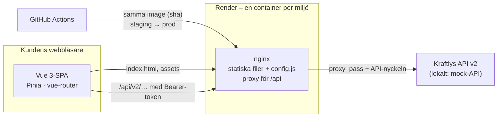
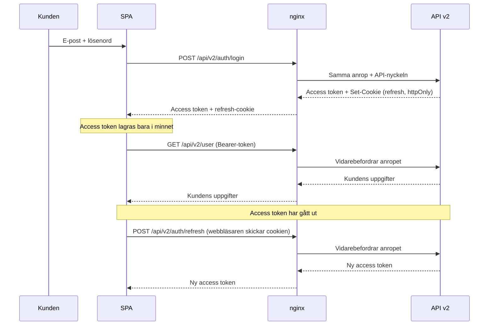

# Arkitektur

## Översikt

Portalen är en SPA byggd med Vue 3 och Vite. Bygget blir statiska filer som nginx serverar, och nginx är också proxy mot Kraftlys API. Eftersom vi inte använder server-rendering (se [rendering.md](decisions/rendering.md)) finns ingen Node-server att drifta, och samma image kan köras i alla miljöer.

## Lagren i frontend

| Lager         | Ansvar                                       | Regel                                                                                                           |
| ------------- | -------------------------------------------- | --------------------------------------------------------------------------------------------------------------- |
| `views/`      | Sidorna routern känner till                  | Hämtar data via stores – undantag: `LoginView`, `InvoicesView` och `MoveFormView` anropar `services/api` direkt |
| `components/` | Återanvändbara delar (`KButton`, `KField` …) | Vet ingenting om API:t                                                                                          |
| `stores/`     | Tillstånd som delas mellan vyer (Pinia)      | Anropar `services/`                                                                                             |
| `services/`   | HTTP mot API:t, token i minnet               | Ingen Vue-kod                                                                                                   |
| `utils/`      | Rena funktioner                              | Inga sidoeffekter – därför lätta att testa                                                                      |
| `router/`     | Rutterna och vakten för inloggning           | Skickar utloggade till `/login`                                                                                 |

Beroendena pekar nedåt: vy → store → service. Aldrig tvärtom.

## Ett flöde: inloggningen

## Miljöer

| Miljö        | Adress                                        | Uppdateras                                 | Norge-flaggan | API                                      |
| ------------ | --------------------------------------------- | ------------------------------------------ | ------------- | ---------------------------------------- |
| Dev (lokalt) | http://localhost:8080 (Docker) · :5173 (Vite) | när du vill                                | på            | mock-API                                 |
| Staging      | https://team-ampere-main.onrender.com         | varje merge till `main`                    | på            | https://kraftly-api-staging.onrender.com |
| Prod         | https://kraftly-teamampere.onrender.com       | samma image som staging, efter godkännande | av            | https://kraftly-api-staging.onrender.com |

Samma image går genom miljöerna – konfigurationen skiljer dem åt, inte koden.

## Beslut

De tre viktigaste – alla beslut finns i [`docs/decisions/`](decisions/README.md):

- [Hosting](decisions/hosting.md) – en container på Render, imagen byggs en gång
- [Tokenlagring](decisions/tokenlagring.md) – access token i minnet, refresh i httpOnly-cookie
- [Feature flags](decisions/feature-flags.md) – Norge bakom en flagga som läses vid körtid

<Era tre – samma som i docs/decisions/README.md. Exemplet är labbrepots val.>
